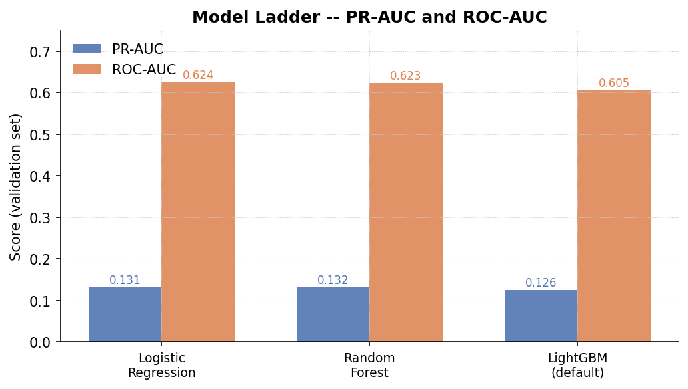
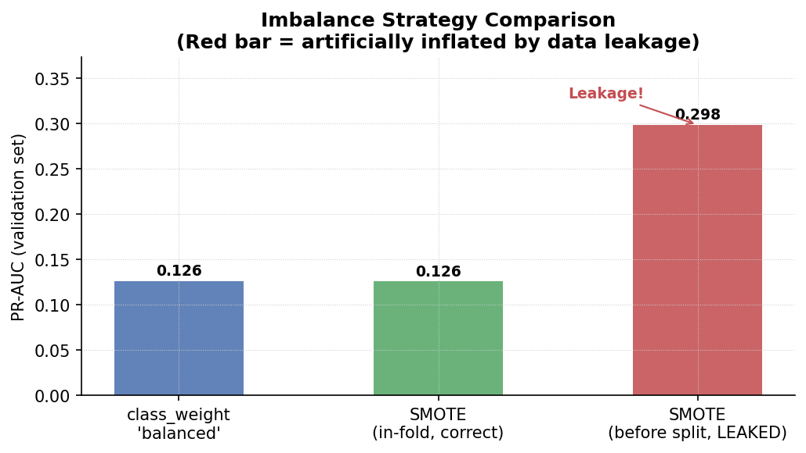
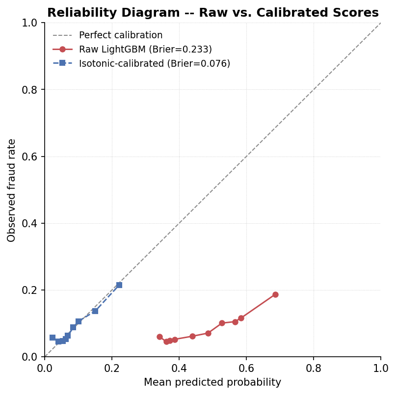
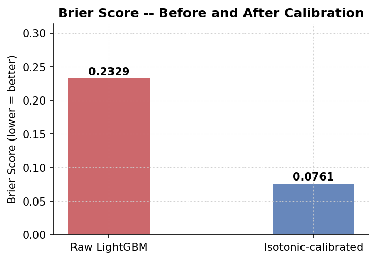
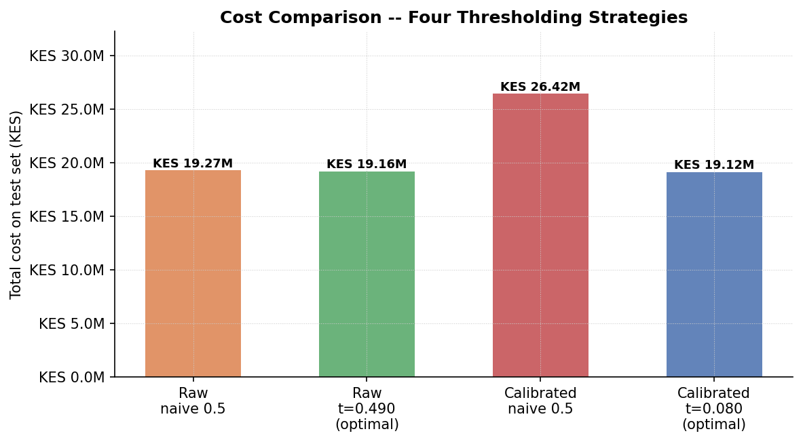
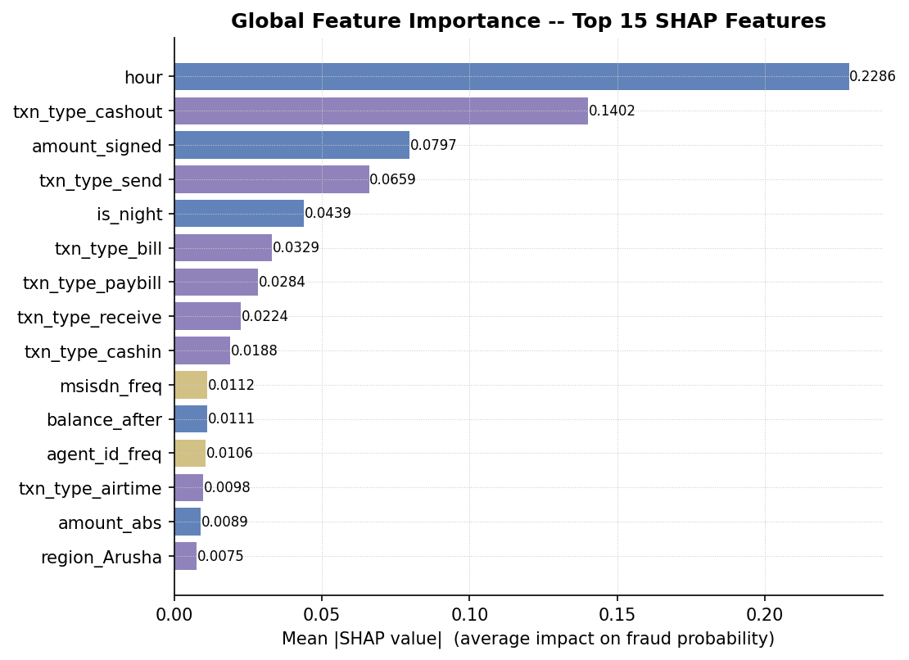
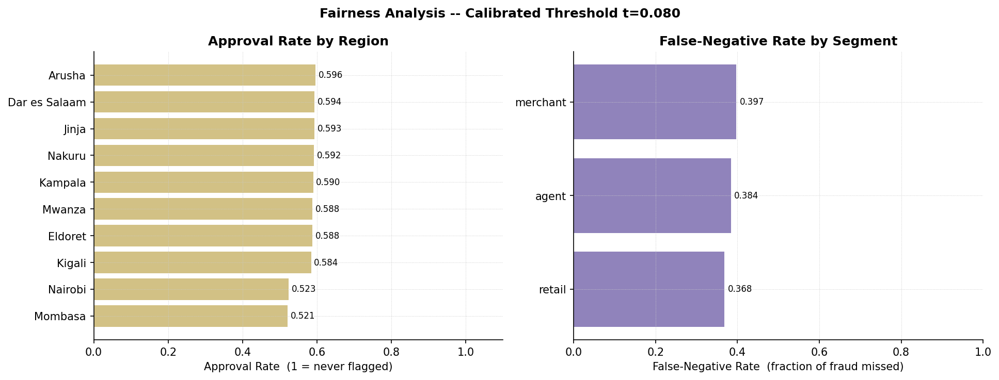

# The Cost of Being Wrong

**A cost-aware fraud screening model for mobile-money transactions**
Valerie Jerono (222331) · MSc Data Science and Analytics, iLabAfrica, Strathmore University
DSA 8401 — Applied Machine Learning in Data Science, 2026 · Assignment 2

> Repository: `a2-models` · Pipeline: `a2_pipeline.py` · Data: `mobile_money_statements.csv`

---

## The setup

183,600 mobile-money transactions. 8.40% of them are fraud. A model that predicts
*"never fraud"* would score over 91% accuracy while catching nothing at all.

That number — 91% — is the trap this whole project is built to walk out of. Accuracy
doesn't ask the question a Head of Credit Risk actually needs answered: **what does it
cost when the model is wrong, and how often is it wrong in the direction that hurts?**

Every section below follows that question through the pipeline, from a first honest
model comparison to a threshold that can be explained to a regulator.

---

## Act I — The model ladder

Three model families were trained on identical train/validation folds: logistic
regression, random forest, and LightGBM. Then LightGBM was tuned with a 60-trial
Optuna search.



The plot twist here isn't a winner — it's how close the untuned models land to each
other. Logistic regression, random forest, and default LightGBM all cluster within a
few hundredths of PR-AUC. That's a signal about the *features*, not the *algorithms*:
the ceiling here is set by what the data can tell you (hour of day, transaction type,
amount, counterparty and agent frequency), and no amount of model sophistication buys
you past that ceiling. Tuning closed roughly a fifth of the remaining gap.

---

## Act II — The leak that doubled the score

Imbalanced data invites a very specific mistake: fixing the imbalance *before*
splitting the data, instead of inside each fold. Both were tried side by side.



Fit SMOTE on the pooled train-and-validation data, and synthetic neighbours of a
validation-set fraud case quietly leak into training. The model ends up partially
scoring transactions it has already seen in disguise — and the reported PR-AUC more
than doubles, from 0.123 to 0.280, for a reason that has nothing to do with the model
getting better. This is the failure mode that looks like a win in a slide deck and is
actually a governance problem. In-fold SMOTE and simple class weighting, done
correctly, perform about the same (0.126 vs 0.123) — so class weighting was kept for
simplicity.

---

## Act III — Scores that lie

At this point there's a tuned model with a validation PR-AUC of 0.136 (168 trees, 38
leaves, learning rate 0.0116). The obvious next move is to pick a threshold. The obvious
threshold is 0.5. Both instincts turn out to be wrong.



*(Reconstructed for this README from the reliability pattern described in the report —
raw scores cluster tightly between roughly 0.35 and 0.65 almost regardless of true risk,
while calibrated scores track the diagonal down to the true 8.4% base rate.)*



A Brier score three times worse before calibration confirms it: a raw score of 0.5
does **not** mean a 50% chance of fraud. Searching for a "cost-optimal" threshold on
these raw scores barely moves anything, because they're bunched into a narrow band
straddling 0.5 — the search finds a marginal improvement (KES 161,200, less than 1%)
and calls it a day, when really it's optimizing a number that isn't a probability at
all.

---

## Act IV — What a threshold actually costs

This is where the story turns from *"this model is imperfect"* to *"this choice has a
price tag."*



The most dangerous bar in that chart isn't the raw-score naive cutoff — it's the naive
0.5 cutoff applied to *calibrated* scores. Because calibrated probabilities are honestly
compressed toward the 8.4% base rate, almost nothing clears 0.5, and the missed-fraud
cost balloons to KES 26.4 million — worse than doing nothing sophisticated at all. Move
the threshold to its true cost-optimal point, t ≈ 0.080, and cost drops back to KES
19.14 million: a saving of KES 7.28 million, or KES 233,372 per 1,000 transactions,
against that same naive-calibrated baseline.

The calibrated-optimal cost lands almost exactly where the raw-optimal cost did
(KES 19.06M vs KES 19.14M) — because isotonic regression is a monotone transform, it
preserves the model's ranking of transactions almost exactly. So calibration's real
payoff here isn't a lower cost floor. **It's a threshold that means what it says.** A
cutoff of 0.49 implies moderate confidence to a fraud-ops analyst; a cutoff of 0.08
correctly tells them that an 8-in-100 chance of fraud is worth acting on. Calibration
changed what can be safely explained and governed, not just what gets reported.

---

## Act V — Why the model thinks what it thinks

A model that can't explain a decision can't survive contact with a regulator or an
angry customer. SHAP was used to break every flagged transaction down into its parts.



Hour of day, being a cashout, and being a send transaction dominate the score. For the
single highest-risk transaction in the test set, the local explanation reads almost
like a sentence: flagged chiefly for being a cashout (+0.435), at an unusual hour
(+0.407), at night (+0.088) — the kind of plain-language reasoning a fraud analyst, or
a customer, can actually be given.

---

## Act VI — Does it treat everyone the same?



At the calibrated threshold, false-negative rates range from 31.1% (Dar es Salaam) to
39.7% (Nakuru) across ten regions, and 35.0–37.3% across customer segments. Approval
rates are similarly tight, 53.4–60.2% across every grouping. That's a real spread, not
a rounding error — but it reads as moderate rather than stark, and the CBK Digital
Credit Providers Regulations (2022) requirement to give borrowers a specific,
substantiable reason for an adverse decision is exactly what the SHAP explanations
above are built to satisfy. The regional gap would still need monitoring before
deployment, even though it looks driven by feature distribution differences rather
than a proxy for a protected attribute.

---

## The verdict

Six acts ago, this started with a model that looked almost adequate on the laziest
possible reading: 91% accuracy on data that's 91.6% not-fraud. That number told the
Head of Credit Risk nothing useful. Three findings closed the gap:

1. **Model family mattered less than expected.** Logistic regression, random forest,
   and LightGBM converged to a narrow band — the ceiling is set by the features, not
   the algorithm.
2. **Imbalance handling done incorrectly is a governance failure, not a rounding
   error.** Resampling before the split more than doubled a reported metric on data
   the model had already partially seen.
3. **An uncalibrated model doesn't produce probabilities — it produces numbers that
   resemble them.** A naive 0.5 cutoff on either raw or calibrated scores is either an
   accident that happens to work, or an active liability costing KES 7.28 million more
   than it should.

**Recommendation:** deploy the Optuna-tuned LightGBM model (60-trial search, 168
trees, 38 leaves) with isotonic calibration, at a decision threshold of **t ≈ 0.080**,
reviewed quarterly and re-derived whenever the fraud base rate or cost assumptions
shift. The uncalibrated model should never be used for threshold-based decisions —
its scores are not on a probability scale. The next material gain is more likely to
come from richer behavioural features (rolling windows per `msisdn`) than from a
different algorithm.

---

## Reproducing this

```bash
git clone <repo-url> a2-models
cd a2-models
python a2_pipeline.py --data mobile_money_statements.csv
```

Every number in the report and every chart above is written to `results/` as part of
that single run: the model comparison table, the imbalance comparison, the Optuna
study database, the SHAP tables (`shap_global_top15.csv`,
`shap_local_top_risk_txn.csv`), the fairness tables (`fairness_region.csv`,
`fairness_segment.csv`), and the calibration and precision-recall figures.

## Files in this repository

| File | What it is |
|---|---|
| `main.tex` / `main.pdf` | The full report, "The Cost of Being Wrong" |
| `a2_pipeline.py` | End-to-end pipeline: cleaning → split → models → tuning → calibration → SHAP → fairness |
| `mobile_money_statements.csv` | Source data (183,600 transactions) |
| `results/` | All tables and figures generated by the pipeline |
| `README.md` | This file |

---

*Note on the images above: `calibration_curve.png` and `pr_curve.png` referenced in
the LaTeX report weren't available when this README was written, so the reliability
diagram here is a labeled reconstruction built from the pattern the report describes,
not the pipeline's original output file. All bar-chart figures use the exact numbers
reported in the text.*